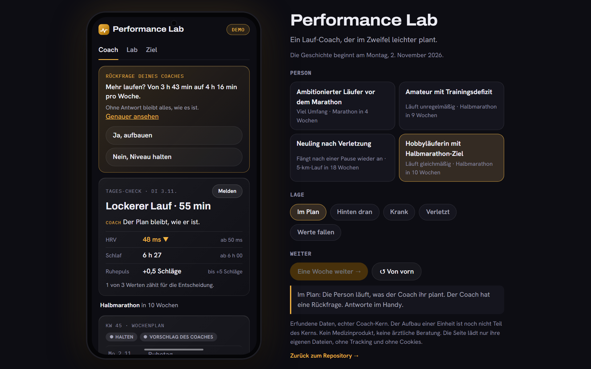
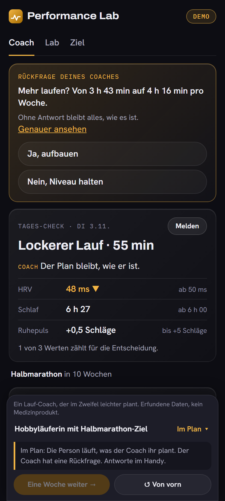
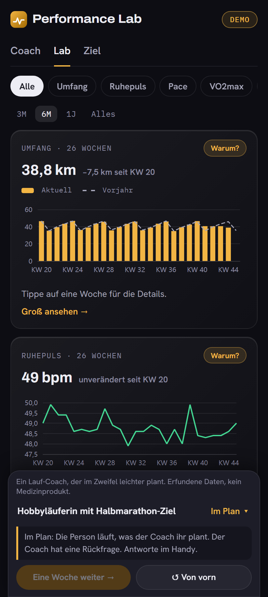
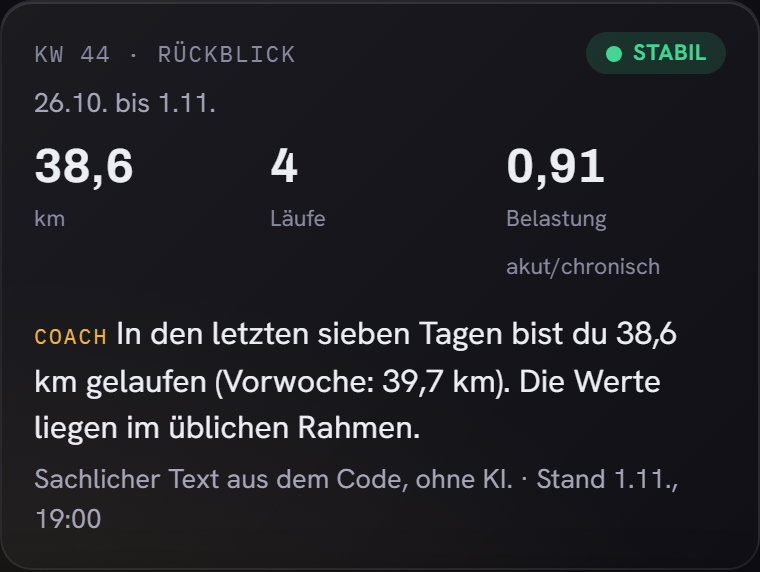
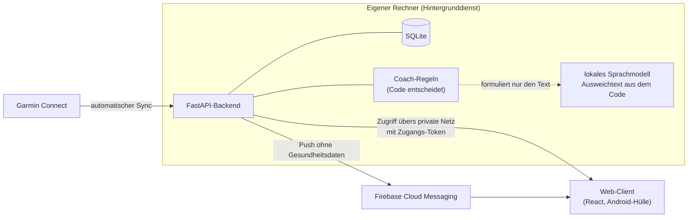

  

**English:** Performance Lab is a personal running coach for Garmin runners. It reads training, sleep, resting heart rate
and HRV, shows long-term trends, and each morning decides whether the planned session stays, gets easier or becomes a
rest day. The live demo runs entirely on synthetic data, no real health data is included, and the page makes no external
requests. Stack: React, TypeScript, ECharts and an Android shell (Capacitor) on the client; Python, FastAPI and SQLite
on the backend; deterministic coaching rules with a local LLM that only phrases the explanation.

  

# Performance Lab

Ein persönlicher Lauf-Coach für Garmin-Läufer: Er liest Training, Schlaf, Ruhepuls und HRV, zeigt die
Entwicklung über Monate und Jahre (das **Lab**) und schlägt jeden Morgen vor, ob die geplante Einheit bleibt,
leichter wird oder ausfällt (der **Coach**). Gebaut als mobile Web-App mit Android-Hülle, für meinen eigenen
Alltag, mit KI-Agenten als Entwicklungsteam und einem Test-zuerst-Vorgehen.

> **Diese Demo zeigt ausschließlich synthetische Beispieldaten** (Stand 06.11.2026). Es sind keine echten
> Gesundheitsdaten enthalten, nicht meine und nicht die von jemand anderem. Die Seite lädt nur ihre eigenen Dateien,
> setzt keine Cookies und hat kein Tracking.

## Ausprobieren

**[▶ Demo öffnen](https://imindahouse.github.io/performance-lab-demo/)**, am Laptop steht die Auswahl rechts neben dem Handy, am Handy im Vollbild mit einer knappen Auswahl am unteren Rand.

Wähle eine der vier erfundenen Personen und eine von fünf Lagen (*Im Plan*, *Hinten dran*, *Krank*, *Verletzt*, *Werte fallen*).
Mit **„Eine Woche weiter“** schreibst du die Geschichte fort, beantwortest Rückfragen des Coaches direkt im Handy und siehst
in der Zeile **„Was ist passiert“**, was die Person getan hat und in welchem Zustand der Wochenplan jetzt steht. Jeder Verlauf
ist beim Bau mit dem echten Coach-Kern aus synthetischen Daten vorberechnet.

| Bereich | Was die Demo zeigt |
|---|---|
| **Coach** | Tages-Check nach den Nachtwerten mit Begründung, Wochenplan (Plan gegen aktuell), Wochenrückblick mit Ampel und Coach-Satz |
| **Lab** | sechs Metriken (Umfang, Ruhepuls, Pace, VO2max, HRV, Schlaf) über 3 Monate bis „Alles“, Woche antippen für die Details, auffällige Tage markiert, „Warum?“ erklärt die Entwicklung |
| **Aufbau einer Einheit** | Ein Tipp auf einen Tag im Wochenplan zeigt, wie sich die Einheit gliedern ließe (Einlaufen, harter Teil, Trab, Auslaufen), mit Puls und erwartetem Tempo. Das ist noch nicht Teil des Coach-Kerns |
| **Ziel** | nächster Wettkampf mit Prognose und Zielfenster, Tapering-Check; Anlegen und Ändern gibt es in der Demo nicht |

<table>
  <tr>
    <td width="33%" valign="top"> <b>Coach:</b> Tages-Check mit den Nachtwerten und Wochenplan</td>
    <td width="33%" valign="top"> <b>Lab:</b> Umfang mit Vorjahreslinie, Ruhepuls, Pace und mehr</td>
    <td width="33%" valign="top"> <b>Rückblick:</b> Der Rückblick steht auf „stabil“: Der Einbruch ist fast aus den letzten sieben Tagen herausgelaufen. Die Demo-Person hat eine eingebaute Einbruchswoche (HRV sinkt, Ruhepuls steigt).</td>
  </tr>
</table>

Die Demo zeigt den Stand der Software, nicht mehr: Der Kern des Trainingsplans ist neu gebaut und noch nicht durch Fachleute
geprüft, seine Zahlen sind vorläufig.

## Wie es gebaut ist

| Schicht | Technik |
|---|---|
| Client | React, TypeScript, Vite, ECharts; Android-App über Capacitor; Updates der Oberfläche ohne neue APK |
| Backend | Python, FastAPI, SQLite (Postgres ist der geplante Weg für mehrere Nutzer) |
| Coach | deterministische Regeln im Code; ein lokales Sprachmodell formuliert nur die Begründung, fällt es aus, schreibt der Code den Text |
| Daten | `python-garminconnect`, Zugangsdaten nie im Klartext in der Datenbank |
| Betrieb | Dienst auf dem eigenen Rechner, Zugriff vom Handy übers private Netz plus Zugangs-Token, tägliches und wöchentliches Backup |
| Prüfung | pytest, Node-Unit-Tests, Playwright, GitHub Actions |

Leitgedanken: **Code entscheidet, das Sprachmodell kommuniziert.** Die Tagesanpassung darf nur *entschärfen*, nie
verschärfen: Ein Fehler in dieser Regel macht den Tag nie härter als geplant. Übersieht sie eine Störung, bleibt es beim Plan.
Sie ersetzt also weder das eigene Gefühl noch eine Ärztin oder einen Arzt. Push-Nachrichten
enthalten nie Gesundheitsdaten, nur das Ereignis. Der Client rechnet keine fachlichen Kennzahlen, er zeigt, was das
Backend liefert.

## So entsteht diese Demo

Beim Build rechnet ein Skript vier erfundene Personen in fünf Lagen vor: Es schreibt für jede eine synthetische Datenbank Tag
für Tag fort (Nachtwerte und Läufe der Person), und derselbe Backend-Code wie im echten Betrieb plant die Woche, entscheidet den
Tages-Check, stellt Rückfragen und nimmt die Antworten entgegen. Aus jedem Zustand legt das Skript alle Antworten ab, die der
Client braucht (das sind rund 250 Zustände, zusammen etwa 17 MB, gezippt knapp 4 MB). Die Seite liest nur diese Dateien, es gibt
kein Backend und keinen Token. Eine Antwort im Handy wählt den passenden vorberechneten Zustand, es wird nichts gesendet. Die
Beispieldaten kommen aus einem Generator mit festen Läuferprofilen. Eine Content-Security-Policy der Seite erlaubt dem Browser
keine Verbindung zu fremden Adressen, und vor jeder Veröffentlichung prüft ein Skript den fertigen Build auf Datenabfluss.

Der Quellcode ist privat und auf Anfrage einsehbar. Dieses Repository enthält nur den fertigen Build und diese
Beschreibung.

## Wie ich teste

Fachlich riskante Teile, vor allem der Trainingsplan, bekommen **ausführbare Spezifikations-Tests, bevor der Code
geschrieben wird**: Jede Eigenschaft („eine Anpassung macht nie härter“, „nach einer Pause beginnt der Aufbau unter dem
alten Niveau“) ist ein Test. Den Code baue ich, bis diese Tests grün sind, und schwäche sie nie ab, damit er besteht.
**Gesundheitsgrenzen entscheidet ein Mensch**, nicht der Code und nicht ein KI-Agent: Schwellen und Grenzwerte
sind eine Entscheidung, die ich anhand der Literatur treffe und dokumentiere. Daneben laufen Unit-, API- und
Ende-zu-Ende-Tests (Playwright gegen ein Demo-Backend), alles in GitHub Actions. Getestet wird ausschließlich mit
synthetischen Daten, die echte Datenbank ist für Tests gesperrt, eine Leitplanke im Test-Setup erzwingt das.

## Grenzen

Das ist ein persönliches Projekt und **kein Medizinprodukt, keine ärztliche Beratung**. Die Trainingsvorschläge ersetzen
weder eine Ärztin noch einen Arzt noch eine Physiotherapeutin. Die Zahlen des Coach-Plans sind vorläufig. Zwei andere
KI-Modelle haben den Plan gelesen, eine Prüfung durch Fachleute steht aus.

## Autor

[imindahouse](https://github.com/imindahouse)
