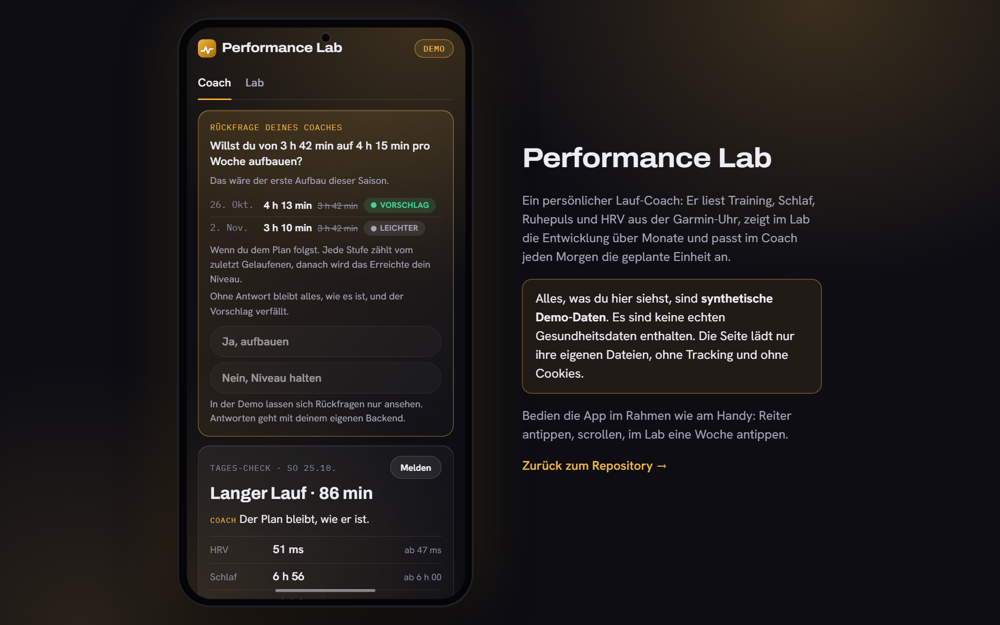
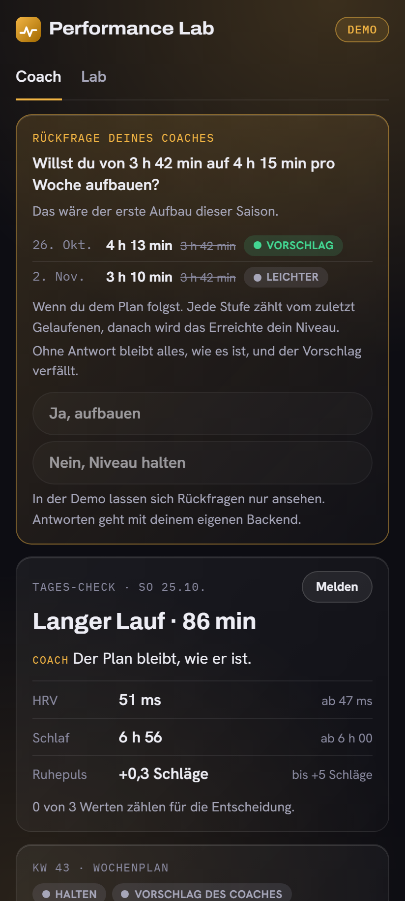
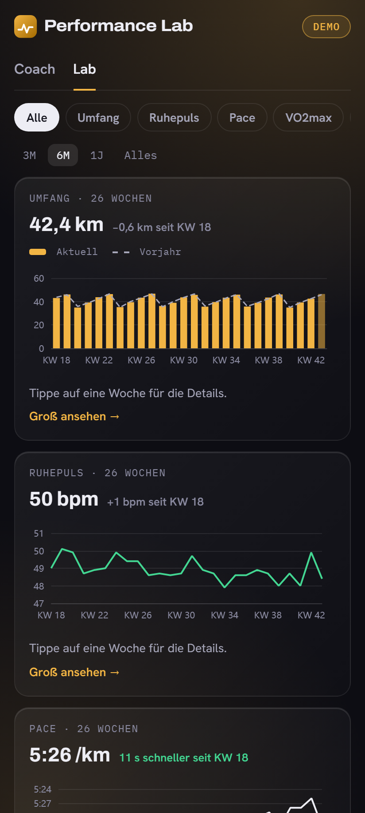
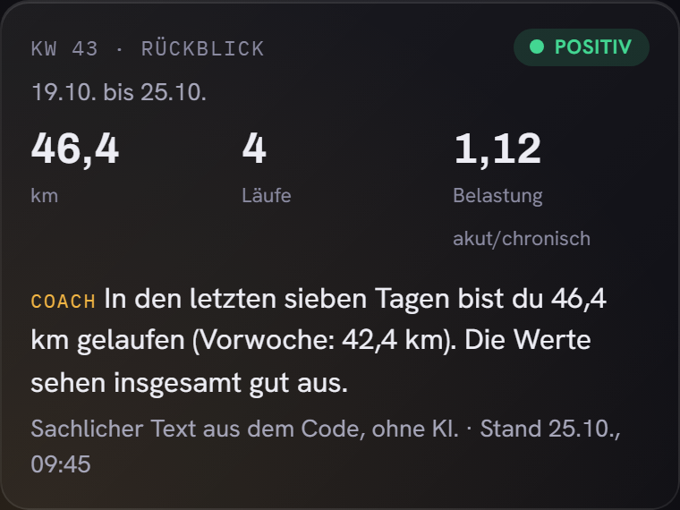
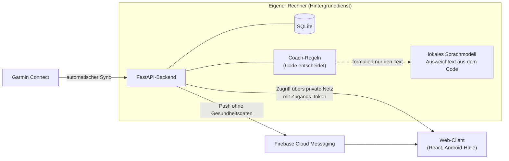

  

**English:** Performance Lab is a personal running coach for Garmin runners. It reads training, sleep, resting heart rate
and HRV, shows long-term trends, and each morning decides whether the planned session stays, gets easier or becomes a
rest day. The live demo runs entirely on synthetic data, no real health data is included, and the page makes no external
requests. Stack: React, TypeScript, ECharts and an Android shell (Capacitor) on the client; Python, FastAPI and SQLite
on the backend; deterministic coaching rules with a local LLM that only phrases the explanation.

  

# Performance Lab

Ein persönlicher Lauf-Coach für Garmin-Läufer: Er liest Training, Schlaf, Ruhepuls und HRV, zeigt die
Entwicklung über Monate und Jahre (das **Lab**) und schlägt jeden Morgen vor, ob die geplante Einheit bleibt,
leichter wird oder ausfällt (der **Coach**). Gebaut als mobile Web-App mit Android-Hülle, für meinen eigenen
Alltag, mit KI-Agenten als Entwicklungsteam und einem Test-zuerst-Vorgehen.

> **Diese Demo zeigt ausschließlich synthetische Beispieldaten** (Stand 25.10.2026). Es sind keine echten
> Gesundheitsdaten enthalten, nicht meine und nicht die von jemand anderem. Die Seite lädt nur ihre eigenen Dateien,
> setzt keine Cookies und hat kein Tracking.

## Ausprobieren

**[▶ Demo öffnen](https://imindahouse.github.io/performance-lab-demo/)**, am Handy im Vollbild, am Laptop in einem Handyrahmen.

| Bereich | Was die Demo zeigt |
|---|---|
| **Coach** | Tages-Check nach den Nachtwerten mit Begründung, Wochenplan (Plan gegen aktuell), Wochenrückblick mit Ampel und Coach-Satz |
| **Lab** | sechs Metriken (Umfang, Ruhepuls, Pace, VO2max, HRV, Schlaf) über 3 Monate bis „Alles“, Vorjahreslinie, Woche antippen für die Details, auffällige Tage markiert |

<table>
  <tr>
    <td width="33%" valign="top"> <b>Coach:</b> Tages-Check mit den Nachtwerten und Wochenplan</td>
    <td width="33%" valign="top"> <b>Lab:</b> Umfang mit Vorjahreslinie, Ruhepuls, Pace und mehr</td>
    <td width="33%" valign="top"> <b>Rückblick:</b> Der Rückblick steht auf „positiv“: Der Einbruch liegt hinter der Demo-Person und taucht in den letzten sieben Tagen nicht mehr auf. Die Demo-Person hat eine eingebaute Einbruchswoche (HRV sinkt, Ruhepuls steigt).</td>
  </tr>
</table>

**In Arbeit** und deshalb in der Demo nicht enthalten: der Bereich *Ziel* (Wettkampf, Zielzeit-Prognose, Tapering) und
die Erklärung „Warum ändert sich der Wert?“ im Lab. Auch der Kern des Trainingsplans wird gerade neu gebaut, Wochenplan
und Tages-Check zeigen in der Demo den bisherigen Stand.

## Wie es gebaut ist

| Schicht | Technik |
|---|---|
| Client | React, TypeScript, Vite, ECharts; Android-App über Capacitor; Updates der Oberfläche ohne neue APK |
| Backend | Python, FastAPI, SQLite (Postgres ist der geplante Weg für mehrere Nutzer) |
| Coach | deterministische Regeln im Code; ein lokales Sprachmodell formuliert nur die Begründung, fällt es aus, schreibt der Code den Text |
| Daten | `python-garminconnect`, Zugangsdaten nie im Klartext in der Datenbank |
| Betrieb | Dienst auf dem eigenen Rechner, Zugriff vom Handy übers private Netz plus Zugangs-Token, tägliches und wöchentliches Backup |
| Prüfung | pytest, Node-Unit-Tests, Playwright, GitHub Actions |

Leitgedanken: **Code entscheidet, das Sprachmodell kommuniziert.** Die Tagesanpassung darf nur *entschärfen*, nie
verschärfen, ein Fehler macht das Training im schlimmsten Fall zu vorsichtig, nie gefährlich. Push-Nachrichten
enthalten nie Gesundheitsdaten, nur das Ereignis. Der Client rechnet keine fachlichen Kennzahlen, er zeigt, was das
Backend liefert.

## So entsteht diese Demo

Der Client hat eine eingebaute Demo-Betriebsart: Beim Build startet ein Skript das Backend im Demo-Modus
(gegen eine synthetische Datenbank, nie gegen echte Daten), ruft alle Endpunkte ab, die der Client braucht, und legt
die Antworten als JSON-Dateien ab. Die Seite liest nur diese Dateien, es gibt kein Backend und keinen Token. Die
Beispieldaten kommen aus einem Generator mit festen Läuferprofilen, die Zahlen auf dem Bildschirm rechnet derselbe
Backend-Code wie im echten Betrieb. Eine Content-Security-Policy der Seite erlaubt dem Browser keine Verbindung zu
fremden Adressen, und vor jeder Veröffentlichung prüft ein Skript den fertigen Build auf Datenabfluss.

Der Quellcode ist privat und auf Anfrage einsehbar. Dieses Repository enthält nur den fertigen Build und diese
Beschreibung.

## Wie ich teste

Fachlich riskante Teile, vor allem der Trainingsplan, bekommen **ausführbare Spezifikations-Tests, bevor der Code
geschrieben wird**: Jede Eigenschaft („eine Anpassung macht nie härter“, „nach einer Pause beginnt der Aufbau unter dem
alten Niveau“) ist ein Test. Den Code baue ich, bis diese Tests grün sind, und schwäche sie nie ab, damit er besteht.
**Gesundheitsgrenzen entscheidet ein Mensch**, nicht der Code und nicht ein KI-Agent: Schwellen und Grenzwerte
sind eine Entscheidung, die ich anhand der Literatur treffe und dokumentiere. Daneben laufen Unit-, API- und
Ende-zu-Ende-Tests (Playwright gegen ein Demo-Backend), alles in GitHub Actions. Getestet wird ausschließlich mit
synthetischen Daten, die echte Datenbank ist für Tests gesperrt, eine Leitplanke im Test-Setup erzwingt das.

## Grenzen

Das ist ein persönliches Projekt und **kein Medizinprodukt**. Die Trainingsvorschläge sind keine ärztliche oder
therapeutische Beratung, und die Zahlen des Coach-Plans sind vorläufig und noch nicht extern geprüft.

## Autor

[imindahouse](https://github.com/imindahouse)
